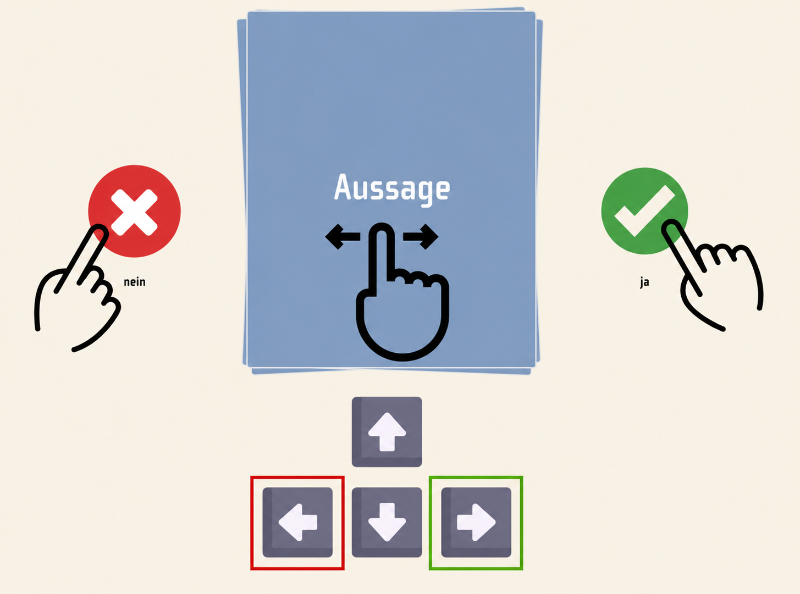

##  MILESTONES: Parent report of milestones across developmental domains


### Description
xxx



### Project Structure

```
.
├── public                      
    ├── data                    <-- scripts for uploading data to server
    ├── images                  <-- logos etc. 
    ├── all html pages          <-- index, instructions, questionnaire and goodbye page
├── src                         <-- folder containing all CSS and JavaScript for functionality
└── ...some more config files                      

```


### Development

Development requires [Node.js](https://nodejs.org/en/)

